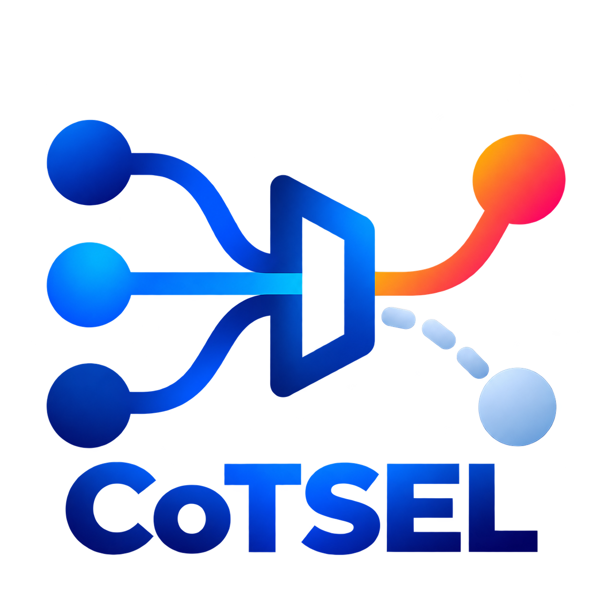

# Correctness Conditioning as Selection in Chain-of-Thought Faithfulness Evaluation

<h1 align="center">Correctness Conditioning as Selection in Chain-of-Thought Faithfulness Evaluation</h1>

<p align="center">
  <strong>The faithful trace. The wrong evidence.</strong><br>
  A causal research exhibit for measuring how correctness conditioning changes chain-of-thought faithfulness evaluation.
</p>

<p align="center">
  <a href="public/docs/arxiv/main_arxiv.pdf">📄 Paper</a>
  &nbsp;·&nbsp;
  <a href="https://ccs-cotfe.github.io/CCS-CoTFE/">🌐 Website</a>
  &nbsp;·&nbsp;
  <a href="public/code/index.html">💻 Code</a>
</p>

<p align="center">
  <a href="https://github.com/CCS-CoTFE/CCS-CoTFE/actions/workflows/deploy-pages.yml"></a>
  
  
</p>

<p align="center">
  <br>
  Yueer Pan<sup>1</sup>
  &nbsp;·&nbsp;
  Yuexi Pan<sup>2</sup>
  <br>
  <sup>1</sup> Zhejiang University
  &nbsp;&nbsp;
  <sup>2</sup> University of Science and Technology of China
</p>

<p align="center">
  <a href="mailto:panjoel@zju.edu.cn">panjoel@zju.edu.cn</a>
  &nbsp;·&nbsp;
  <a href="mailto:panyuexi@mail.ustc.edu.cn">panyuexi@mail.ustc.edu.cn</a>
</p>

---

## ✦ Why CoTsel?

Correctness conditioning is often treated as a harmless filter in intervention-based chain-of-thought evaluation. The paper shows that it changes the estimand: a faithful trace can remain locally accurate while becoming the wrong evidence for the population-level claim.

The exhibit turns that claim into a readable path from the structural causal model to the measured evidence: an interactive causal lens, benchmark-level effects, a literature audit, a covariance decomposition, response curves, and the paper's source figures.

## 🧭 What it tests

- **Selection as a causal operator:** correctness opens a path that can shift the faithfulness estimate.
- **Seven-variable structural model:** difficulty, shortcut competence, reliance, trace, correctness, answer change, and the intervention path remain visible.
- **Evidence across scales:** 18 screened evaluations, 16 conditioning-dependent reports, a primary +7.4 percentage-point shift, and pooled OR = 1.70.
- **Interactive reading:** scroll through Idea, Benchmark, and Evidence while selecting paths, chart rows, matrix cells, and source figures.

The central question is simple:

> When does a faithful trace remain valid evidence after correctness conditioning?

## 🚀 Quick start

Node.js 20 or newer and pnpm 12 are recommended.

```bash
git clone https://github.com/CCS-CoTFE/CCS-CoTFE.git
cd CCS-CoTFE
pnpm install
pnpm dev
```

Build and validate the published exhibit:

```bash
pnpm build
pnpm verify:site
```

The `main` branch deploys the website automatically with GitHub Pages through [`.github/workflows/deploy-pages.yml`](.github/workflows/deploy-pages.yml).

## 🗂️ Repository map

| Path | Purpose |
| --- | --- |
| `src/components/` | Navigation and the live Liquid Glass surface bridge |
| `src/pages/` | The three continuous-scroll chapters: Idea, Benchmark, and Evidence |
| `src/styles/` | Global type, color, motion, and responsive rules |
| `public/paper-figures/` | Five source figures from the paper plus a presentation variant |
| `public/docs/arxiv/` | The paper PDF served by the website |
| `public/code/` | The reproducibility and code archive entry point |
| `docs/` | Public architecture and release notes |
| `examples/` | Small reading and interaction examples for the exhibit |
| `tests/` | Site contract documentation and validation scope |
| `scripts/verify-site.mjs` | Deterministic checks for routes, content, assets, and scroll contracts |
| `.github/workflows/` | GitHub Pages build and deployment |

The public tree intentionally leaves out private experiment data, review notes, local archives, and the superseded nested website repository. The interface uses `@glass-sdk/liquid-glass` for the navigation capsule while keeping research cards calm and legible around the source figures.

## 📚 Citation

```bibtex
@misc{pan2026ccscotfe,
  title = {Correctness Conditioning as Selection in Chain-of-Thought Faithfulness Evaluation},
  author = {Pan, Yueer and Pan, Yuexi},
  year = {2026},
  url = {https://ccs-cotfe.github.io/CCS-CoTFE/}
}
```

The linked paper is a preprint. The paper PDF, interactive exhibit, and code archive are available from the links at the top of this page.

## ⚖️ License

The authors have not published a separate code or manuscript license in this release. Until a license is added, the repository is available for viewing and citation while reuse remains subject to the authors' permission. See [`NOTICE`](NOTICE) for the release boundary.
